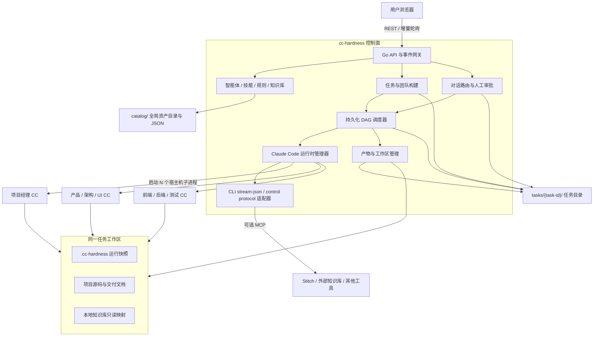
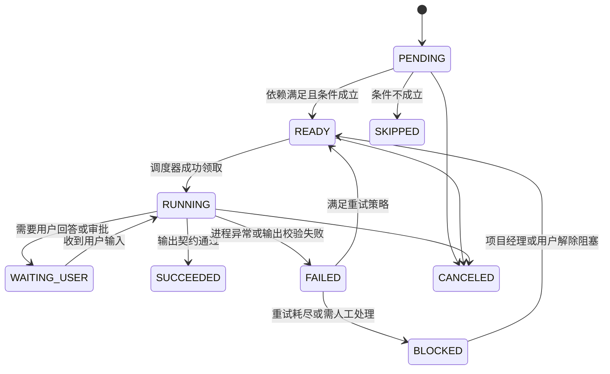
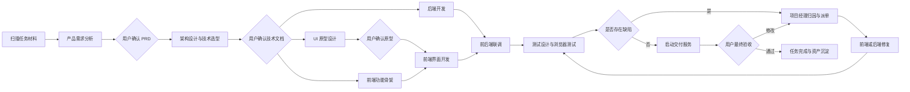

# cc-hardness 架构设计

> 文档版本：v1.2  
> 文档状态：已实现基线  
> 更新日期：2026-07-29  
> 依据文档：《项目架构.md》  
> 项目定位：基于 Claude Code CLI 的多智能体软件研发编排与交付平台

## 1. 文档目的

本文档定义 cc-hardness 的总体架构、技术选型、功能边界、核心业务流程、关键技术原理、文件数据模型、接口与事件协议、部署方式以及实施路线。它既用于统一产品和研发认知，也作为后续详细设计、文件结构设计和任务拆分的上游依据。

当前实现采用 React 本地状态与 Fetch API、Go 标准库 `net/http`、REST 增量轮询和文件型持久化，以较少依赖先交付完整可点击流程。React Flow、WebSocket、OpenAPI 代码生成和可观测性平台属于数据规模或并发压力增长后的可替换增强项，不是当前启动所需依赖。

cc-hardness 不是一个简单的 Claude Code 聊天界面，而是一个能够完成以下闭环的研发控制平台：

1. 管理智能体、技能、规则和知识库等可复用 AI 资产。
2. 根据任务背景和用户文件自动组建智能体团队。
3. 生成用户可编辑、可并行、可等待、可恢复的 DAG 工作流。
4. 在同一项目目录中启动和控制多个 Claude Code CLI 进程。
5. 让产品、架构、UI、前端、后端和测试等角色按约束协同工作。
6. 在需求确认、架构确认、原型确认和最终验收等关键点引入人工决策。
7. 对需求变更、缺陷修复、失败重试和中断恢复形成完整闭环。

## 2. 系统目标与边界

### 2.1 核心目标

- **可管理**：智能体、技能和规则均有清晰来源、状态、版本和关联关系。
- **可编排**：任务不是固定流水线，而是由团队组建智能体生成、用户可编辑的 DAG。
- **可交互**：用户能够按阶段与指定角色直接对话，并能处理 Claude Code 的权限请求。
- **可并行**：没有依赖关系的节点可同时运行，减少完整项目交付时间。
- **可恢复**：后端重启、CLI 异常退出或网络断开后，任务状态不丢失并可继续执行。
- **可追溯**：每次运行使用的智能体版本、技能版本、输入、输出、审批和状态变化均可查询。
- **可扩展**：后续可以增加新角色、新节点类型、MCP 知识库和远程运行节点，而不重写调度核心。

### 2.2 第一阶段不做的内容

- 不实现知识库向量化、Embedding、RAG 排序和向量数据库。
- 不自研大模型推理服务，统一通过本机或运行节点上的 Claude Code CLI 工作。
- 不在第一阶段拆分微服务，也不引入 Redis、Kafka 等额外基础设施。
- 不承诺读取 Claude Code 内部子智能体的私有上下文，只处理 CLI 对外输出的标准事件。
- 不直接替代 Git、CI/CD、Stitch 或浏览器自动化工具，而是通过智能体、技能、MCP 和命令适配器调用它们。

### 2.3 部署假设

第一阶段采用**本地优先、单节点运行、浏览器访问**的 B/S 架构。后端必须运行在能访问目标项目目录、Claude Code CLI、用户凭证和本地开发工具的宿主机上。前端可由同一个 Go 服务托管，也可在开发阶段由 Vite 独立运行。

## 3. 总体架构

### 3.1 架构风格

系统采用“**模块化单体控制面 + 多 Claude Code 子进程运行面**”架构：

- 控制面负责资产管理、任务构建、DAG 调度、会话路由、审批、持久化和 Web API。
- 运行面由多个隔离的 Claude Code CLI 子进程组成，每个进程绑定一个任务成员、工作目录和会话。
- 文件目录和 JSON 文件保存业务事实与调度状态；每个任务目录同时是该任务的工作目录、状态目录和全部交付文件的存放位置。
- REST API 负责查询与命令；浏览器按会话序号增量轮询聊天、权限和进程事件，后续可无损升级为 WebSocket。

选择模块化单体而非微服务，是因为第一阶段的状态文件、进程生命周期和本地项目文件联系紧密。单体能让文件锁、原子写入和进程调度保持在同一宿主机内；模块边界仍保持清晰，未来可以在确有需要时把运行时执行器拆成远程 Worker。

### 3.2 逻辑架构图



### 3.3 控制面与项目工作区的职责边界

| 内容 | 权威数据源 | 说明 |
|---|---|---|
| 智能体、技能、规则的元数据和版本 | `data/catalog/` | 每类资产一个目录，索引 JSON 加不可变版本文件 |
| 任务基本信息、团队和任务目录索引 | `data/tasks/{task-id}/task.json` | 每个任务目录自描述，任务列表通过启动时扫描构建 |
| DAG 节点、依赖、运行状态、重试次数 | `data/tasks/{task-id}/.cc-hardness/workflow/` | 已发布定义与运行状态分离，调度器只读取受控状态文件 |
| 聊天消息、审批、权限决策、状态事件 | `data/tasks/{task-id}/.cc-hardness/` | 使用 JSONL 追加日志支持断线重放和完整审计 |
| 智能体/技能实际运行快照 | `.cc-hardness/runtime/` | 任务启动后固定版本，避免资产库更新影响进行中的任务 |
| PRD、设计、源码、测试报告 | 项目工作区 | 用户和各智能体共同操作的真实交付物 |
| 大体积原始 NDJSON 与 stderr | `.cc-hardness/logs/` | 按会话分文件保存，避免单个 JSON 文件无限增长 |

## 4. 技术栈与选型说明

### 4.1 推荐技术栈

| 层次 | 技术 | 用途 |
|---|---|---|
| 前端语言与框架 | TypeScript + React 19 + Vite | 管理后台、聊天、DAG 编辑、实时状态展示 |
| UI 与样式 | 原生 CSS + Lucide React | 构建轻量、精致、可维护的桌面级交互界面 |
| 前端状态 | React Hooks + Fetch API | 管理服务端事实、表单草稿、聊天事件和 DAG 编辑状态 |
| DAG 编辑 | React 受控列表与节点编辑器 | 节点增删改、依赖、执行人、阶段和状态可视化 |
| 文档/代码展示 | 原生文本编辑器与 Markdown 源码视图 | 查看和发布智能体、技能、规则及知识库版本 |
| 后端语言 | Go 1.24+ | 高并发流处理、子进程控制和跨平台单文件部署 |
| HTTP 路由 | Go 标准库 `net/http.ServeMux` | REST API、方法路由、安全头和 SPA 静态资源托管 |
| 实时通信 | REST 序号增量轮询 | CLI 增量消息、状态事件和权限请求；保留 WebSocket 升级边界 |
| 持久化 | 文件目录 + JSON + JSONL | 本地透明存储、可复制、可归档、无需数据库服务 |
| 文件写入 | 临时文件 + fsync + 原子替换 | 防止进程中断留下半写 JSON |
| 并发控制 | 进程内读写锁 + 任务级文件锁 | 防止同一任务状态被并发覆盖 |
| 接口规范 | Go/TypeScript 对应类型 + JSON 校验 | REST 契约、请求边界和任务计划结构校验 |
| 日志 | Go `slog` 结构化日志 | 正常和状态流转使用 info，异常使用 error |
| 可观测性 | `slog` + 任务本地 NDJSON/stderr 日志 | 进程、会话、节点和失败诊断；指标系统作为后续增强 |
| 外部集成 | MCP + CLI/脚本适配器 | Stitch、浏览器测试、本地知识库和其他研发工具 |

### 4.2 为什么后端选择 Go

cc-hardness 的主要难点是同时管理多个长生命周期 CLI 子进程、并发读取 stdout/stderr、串行写入 stdin、维护有序事件以及驱动 DAG，而不是复杂的传统企业业务计算。Go 的 goroutine、锁、`context` 和 `os/exec` 与这一问题天然匹配，并且能生成便于本地部署的单个可执行文件。

备选方案比较如下：

| 方案 | 优点 | 不作为首选的原因 |
|---|---|---|
| Java + Spring Boot | 团队熟悉、CRUD 和企业生态完整 | JVM 体积更大；进程流与高频实时事件代码较重；本地单文件交付不如 Go 简洁 |
| Node.js + TypeScript | 前后端同语言、流处理方便 | 多进程生命周期、CPU 隔离和长期运行可靠性需要更多约束；依赖部署体积较大 |
| Rust | 进程控制、性能和 Tauri 集成优秀 | 学习和开发成本更高；本项目首先是 Web 控制平台，不需要把内存安全收益放在交付速度之前 |
| Python | AI 生态丰富、原型快 | 长期并发进程管理、类型约束和单文件跨平台交付相对弱，本项目也不做模型推理 |

如现有团队强制统一 Java，也可以用 Spring Boot 实现控制面，但应保持本文定义的 CLI 适配器、进程管理器和 DAG 调度边界不变。

### 4.3 为什么前端选择 React

React 适合 DAG 编辑、复杂聊天面板、多标签会话和流式增量渲染。当前使用 Hooks 和受控组件完成状态管理，减少首版依赖；当 DAG 规模增长到需要拖拽连线和自动布局时，可在不改变后端计划结构的前提下替换为 React Flow。

### 4.4 文件持久化决策

系统不使用 PostgreSQL、SQLite、Redis 或其他数据库。`data/` 是平台持久化根目录，`data/catalog/` 保存全局资产，`data/tasks/` 下每个一级文件夹就是一个完整任务。任务源代码、交付文档、对话、流程状态、运行日志和审批记录全部位于该任务文件夹内，复制一个任务目录即可完成迁移或归档。

文件持久化遵循以下规则：

- 小型当前状态使用 JSON，例如 `task.json`、`team.json`、`runtime-state.json`。
- 高频且只追加的数据使用 JSONL，例如 `events.jsonl`、`messages.jsonl`、`audit.jsonl`。
- 大体积 CLI 原始流按会话保存 NDJSON 文件，不重复塞入状态 JSON。
- 更新 JSON 时先在同目录写临时文件、刷新磁盘，再原子替换目标文件。
- 每个状态文件包含 `schemaVersion`、`revision` 和 `updatedAt`；写入时校验 revision，避免后写覆盖先写。
- Go 进程内使用任务级读写锁；同时通过 `.cc-hardness/task.lock` 阻止两个 cc-hardness 实例操作同一任务。
- 平台启动时扫描 `data/tasks/*/task.json` 重建内存索引，不维护额外的中心任务数据库。

## 5. 核心领域与功能设计

### 5.1 智能体管理

智能体由稳定的逻辑实体 `Agent` 和不可变版本 `AgentVersion` 组成。

**基本信息**：名称、标识、描述、头像、来源类型（SYSTEM、USER、AI）、角色类型、启用状态、当前默认版本。  
**版本信息**：语义版本、智能体本体 Markdown、变更说明、创建来源、创建时间、默认技能版本集合、内容哈希。  
**操作**：新增、编辑元数据、创建版本、启用/禁用、切换默认版本、查看版本内容、查询关联任务。

实现约束：

- 已被任务引用的版本不可原地修改，只能创建新版本。
- 禁用表示不能被新任务选择，不影响已生成快照并运行中的任务。
- AI 临时生成的智能体先标记为 `AI_DRAFT`，任务结束后由项目经理智能体形成评估报告，用户确认后才能进入正式智能体库。
- 项目经理是系统内置智能体，任务团队中必须且只能存在一个，不能被删除。

### 5.2 技能管理

虽然原始需求只要求技能基本管理，架构上仍建议使用 `Skill + SkillVersion`，否则修改技能会破坏历史任务可复现性。

技能字段包括名称、标识、描述、来源类型（SYSTEM、USER、AI）、启用状态、本体 `SKILL.md`、可选资源文件和版本。支持新增、更新版本、删除未引用技能、启用/禁用、查询关联智能体和任务。

任务启动时不直接引用全局技能目录，而是把选定版本复制到任务的 `.claude/skills/<skill-key>/` 中。删除操作默认采用软删除；已有关联版本时禁止物理删除。

### 5.3 规则管理

规则用于给整个任务或单个成员施加稳定约束，例如编码规范、日志规范、禁止命令和交付要求。

规则分为：

- `GLOBAL`：平台级默认规则。
- `TASK`：绑定当前任务的规则。
- `MEMBER`：只绑定指定任务成员的规则。
- `PATH`：对工作区指定路径生效的规则。

规则同样采用不可变版本。工作区构建器按作用域合并规则，检测互斥项并形成最终快照。平台不能只把规则拼成一段提示词，还要把可机器执行的安全规则下沉到权限策略，例如禁止访问工作区外路径。

### 5.4 知识库管理

知识库抽象统一为 `KnowledgeBase`：

- `LOCAL_DIRECTORY`：保存名称、描述和宿主机绝对路径；运行时向智能体提供只读路径和扫描说明，不向量化、不复制全部内容。
- `MCP`：保存 MCP Server 配置引用、能力描述和启用状态；第一阶段只保留数据结构、配置校验和绑定界面，不实现具体检索功能。

知识库可绑定任务或任务成员。绑定时生成快照，记录实际路径/MCP 配置版本。后端必须校验本地路径存在、在允许目录内，并处理符号链接越界问题。

### 5.5 任务管理

任务包括历史查询、新建、暂停、恢复、取消、归档、补充需求和最终验收。核心字段包括名称、任务背景、工作区、当前阶段、状态、团队方案版本、工作流版本、当前对话路由和创建人。

任务状态建议定义为：

```text
DRAFT -> PLANNING -> WAITING_CONFIRMATION -> READY -> RUNNING
RUNNING <-> PAUSED
RUNNING -> ACCEPTANCE -> COMPLETED
任意非终态 -> FAILED / CANCELED
```

`FAILED` 表示系统无法自动继续；单个节点失败不一定导致任务失败，调度器会先按策略重试或交由项目经理生成修复节点。

### 5.6 团队构建

专用的“团队组建智能体”读取任务描述、上传文件清单和目录扫描摘要，输出符合 JSON Schema 的 `TeamPlan` 与 `WorkflowPlan`。后端不直接相信模型输出，而要完成：

1. JSON Schema 校验。
2. 角色、智能体版本和技能版本存在性校验。
3. 项目经理唯一且不可删除校验。
4. DAG 无环校验和依赖引用校验。
5. 路径、命令和知识库权限校验。
6. 并发数、重试次数和人工门禁完整性校验。

默认角色判定策略：

| 角色 | 默认策略 |
|---|---|
| 项目经理 | 必选且固定，负责协调、变更分发和异常裁决 |
| 产品经理 | 默认加入；存在 PRD 时负责分析优化，不存在时负责从背景生成 PRD |
| 架构师 | 默认加入；存在设计文档时负责一致性检查和优化，不存在时负责生成 |
| UI 设计师 | 无可用 UI 稿时加入；已有完整 UI 稿时可由用户移除 |
| 前端工程师 | 存在前端交付范围时加入 |
| 后端工程师 | 存在后端、数据或接口交付范围时加入 |
| 测试工程师 | 默认加入，负责测试计划、自动化验证、报告和缺陷回归 |

用户可在确认页增减非固定成员、更换智能体版本、增加或移除技能、规则和知识库。每次修改触发局部重算，系统应尽量保留用户已锁定的节点与依赖，避免整张 DAG 被 AI 重写。

## 6. 工作流 DAG 设计

### 6.1 节点模型

工作流由节点和有向边组成。不能只设计一个布尔型 `wait` 字段，因为一个节点可能等待多个前驱，也可能只需任一前驱完成。建议节点包含：

| 字段 | 含义 |
|---|---|
| `node_key` | 工作流版本内稳定唯一键 |
| `type` | AGENT、USER_APPROVAL、COMMAND、CHECK、SUMMARY 等 |
| `assignee_member_id` | 执行该节点的任务成员 |
| `phase` | ALIGNMENT、ARCHITECTURE、PROTOTYPE、DEVELOPMENT、TEST、DELIVERY |
| `wait_for` | 前置节点键列表，是用户所需 wait 语义的明确表达 |
| `dependency_mode` | `ALL` 或 `ANY` |
| `condition` | 可选条件表达式，例如“存在 UI 设计师” |
| `input_artifacts` | 节点输入产物 |
| `output_contract` | 输出文件、JSON Schema 或验收条件 |
| `retry_policy` | 最大次数、退避时间和可重试错误类型 |
| `timeout_seconds` | 节点运行超时 |
| `human_gate` | 完成后是否必须等待用户确认 |

### 6.2 节点状态机



`READY` 是可调度状态，`WAITING_USER` 是主动暂停且进程可继续保留，`BLOCKED` 表示目前没有可自动执行路径。节点状态迁移必须持有任务级锁：先原子更新 `runtime-state.json`，再向 `events.jsonl` 追加状态事件。若追加事件失败，恢复器会根据状态文件补写恢复事件。

### 6.3 调度算法

调度器采用单宿主机、文件状态驱动模型：

1. 启动时扫描任务目录，将 `workflow/definition.json` 和 `workflow/runtime-state.json` 加载到内存。
2. 持有任务级互斥锁，计算依赖已满足的 `PENDING` 节点并原子写为 `READY`。
3. 按任务优先级、阶段顺序和创建时间领取节点，给本次运行生成唯一 `runToken`。
4. 检查全局、任务和成员三级并发限额，并检查节点写入范围是否冲突。
5. 在 `.cc-hardness/runs/{node-id}/{attempt}.json` 创建 NodeRun，再准备或复用成员的 Claude 会话。
6. 发送结构化节点指令，并消费 CLI 输出事件。
7. 校验产物和退出条件，使用 `runToken + revision` 更新状态；旧运行结果不能覆盖新的重试结果。
8. 成功后解锁后继节点，失败则按策略重试；所有节点完成后进入最终验收。

第一阶段明确只允许一个 cc-hardness 实例持有某个任务锁。若未来需要远程 Worker，应先增加独立协调服务，不能依赖共享网络磁盘上的普通文件锁实现分布式调度。

### 6.4 推荐的主流程 DAG



后端开发与 UI 原型设计可并行。前端在原型确认前只执行类型、API、路由、状态和无视觉依赖的功能骨架节点；真正的页面样式开发必须依赖原型确认节点。

## 7. Claude Code 进程运行时

### 7.1 启动协议

运行时通过 persistent stream-json 模式启动 Claude Code。启动参数由独立 `ClaudeAdapter` 生成，避免业务代码依赖某一 CLI 版本。参考调用形式：

```bash
claude \
  --input-format stream-json \
  --output-format stream-json \
  --verbose \
  --include-partial-messages \
  --replay-user-messages \
  --permission-mode bypassPermissions \
  --model <model> \
  --resume <claude-session-id>
```

具体参数应在实现时针对部署环境安装的 Claude Code 版本做兼容探测；所有版本差异限制在适配器中。

### 7.2 进程管理器

每个运行会话在内存中至少维护：

- 平台会话 ID、Claude session ID、任务 ID、成员 ID、节点运行 ID。
- PID、工作目录、启动参数、启动时间和当前状态。
- stdin 写入器与互斥锁，保证每条 NDJSON 完整串行写入。
- stdout/stderr 读取协程及有界事件队列。
- 取消上下文、进程退出信号和 WebSocket 订阅者集合。
- 最近活动时间、token 使用摘要和等待中的权限请求。

普通用户消息写入形式：

```json
{"type":"user","message":{"role":"user","content":"请继续完成当前节点"}}
```

所有 stdout 按行解析 NDJSON；stderr 只作为诊断流，不能混入协议解析。增量 token 事件向前端实时转发，但应按 50～100ms 合并后推送，并按消息完成边界写入 JSONL，避免一字一事件造成大量小文件写入和浏览器渲染压力。

### 7.3 权限控制协议

Claude Code 发出的 `control_request.can_use_tool` 必须由后端截获并转为平台权限事件：

1. 根据平台策略判断是否可自动允许或必须人工审批。
2. 涉及工作区外写入、删除、执行高风险命令、读取敏感路径时强制人工审批。
3. 前端展示工具名、参数、影响路径、发起成员和所属节点。
4. 用户允许或拒绝后，后端通过同一 stdin 写回 `control_response`。
5. 每次权限决策持久化，便于审计；不能只存在浏览器状态中。

### 7.4 会话路由

平台会同时存在多个 CC 进程，因此任何消息都不能只按任务 ID 路由，至少要使用 `task_id + member_id + session_id`。

- 意图对齐阶段：主聊天默认直达产品经理。
- 架构确认阶段：架构问题可直达架构师。
- 原型阶段：样式对话直达 UI 设计师。
- 原型确认之后：用户主聊天统一进入项目经理；项目经理将变更形成结构化 `ChangeRequest` 并分配新节点。
- 权限请求和节点级追问：直接路由到实际发起的会话，不经过项目经理转述。

前端应清晰显示“当前正在与谁对话”，并保留切换到成员会话只读视图的能力，避免用户误把消息发送给错误角色。

### 7.5 进程退出与恢复

- 浏览器断开不终止 CC 进程；重连后先从任务目录中的消息和事件 JSONL 回放，再订阅实时事件。
- 正常暂停优先发送 `interrupt` 控制请求，再根据超时决定是否终止进程。
- Unix 使用进程组，Windows 使用 Job Object，确保取消任务时能清理 CLI 派生进程。
- 后端崩溃后无法重新获得旧进程的 stdin 管道，因此启动恢复器应把相关会话标为 `INTERRUPTED`，清理孤儿进程，并用已记录的 Claude session ID 启动 `--resume` 新进程。
- 若无法恢复 Claude session，则新建会话，并注入节点输入、已有产物和上次运行摘要；不得直接把节点误判为成功。

## 8. 任务工作区设计

### 8.1 初始化流程

平台的数据根目录默认为 `./data`，可通过配置改为用户指定的绝对路径。新建任务时在 `data/tasks/` 下创建唯一任务文件夹；这个文件夹本身就是项目工作目录，不再把状态目录和项目源码分散到两个位置。导入已有项目时，将其注册为外部任务目录，并在该目录内创建受控的 `.cc-hardness` 子目录。任务启动前由工作区构建器完成：

1. 解析并校验绝对路径，检查读写权限和符号链接。
2. 识别已存在项目文件、PRD、技术文档、UI 图片和 Git 状态。
3. 创建 `.cc-hardness` 管理目录，不覆盖用户已有文件。
4. 把智能体、技能、规则和配置按选定版本物化到运行快照。
5. 写入任务清单、团队清单、DAG 快照和产物约定。
6. 为本地知识库创建只读引用清单，而不是复制或向量化。
7. 完成后才允许调度器启动成员进程。

### 8.2 推荐目录结构

```text
data/
├── catalog/                    # 全局可复用资产
│   ├── agents/{agent-key}/
│   ├── skills/{skill-key}/
│   ├── rules/{rule-key}/
│   └── knowledge-bases/{kb-key}/
├── config/
│   ├── settings.json           # 平台设置，不包含明文密钥
│   └── task-index.json         # 可重建的任务摘要缓存，不作为权威数据源
└── tasks/
    └── {task-id}/              # 一个文件夹就是一个完整任务与项目工作区
        ├── task.json            # 名称、状态、阶段、revision、时间等任务主信息
        ├── README.md            # 任务说明或项目说明
├── .claude/
│   ├── agents/                 # 物化后的角色智能体 Markdown
│   ├── skills/                 # 物化后的技能目录与 SKILL.md
│   ├── rules/                  # 可直接被 Claude Code 加载的规则
│   └── settings.json           # 当前任务允许的工具、Hook 与 MCP 配置
        ├── .cc-hardness/
│   ├── manifest.json           # 任务、团队和平台版本
│   ├── team.json               # 成员、智能体版本、技能、规则和知识库绑定
│   ├── workflow/
│   │   ├── definition.json     # 当前已确认的 DAG 定义
│   │   ├── runtime-state.json  # 节点当前状态、revision 与活动 runToken
│   │   └── versions/           # 历史工作流定义
│   ├── runtime/
│   │   ├── agents/             # 智能体版本原始快照
│   │   ├── skills/             # 技能版本原始快照
│   │   ├── rules/              # 规则版本原始快照
│   │   └── knowledge.json      # 本地目录/MCP 引用
│   ├── conversations/          # 每个会话的 meta.json 与 messages.jsonl
│   ├── events/events.jsonl     # 任务级可重放事件
│   ├── audit/audit.jsonl       # 权限、审批、版本发布和取消操作
│   ├── runs/                   # 每个节点每次尝试的运行记录
│   ├── messages/               # 可读的跨角色交接单和缺陷单
│   ├── artifacts/              # 平台生成的摘要、清单和验收索引
│   └── logs/                   # 会话 NDJSON、stderr 和进程退出信息
        ├── docs/
│   ├── requirements/           # PRD 与需求确认记录
│   ├── architecture/           # 架构、接口、数据库和安全设计
│   ├── design/                 # 原型说明与设计资产索引
│   ├── test/                   # 测试计划、用例、报告和缺陷
│   └── delivery/               # 启动说明、交付报告和验收结果
        ├── frontend/
        ├── backend/
        └── ...                 # 该任务的全部源码、素材与其他文件
```

任务目录中的受控 JSON/JSONL 是唯一持久化事实。智能体不得直接修改 `.cc-hardness/workflow/runtime-state.json`；该路径通过规则和权限策略限制为平台后端专有。用户在界面修改工作流时，由后端生成新工作流版本并原子更新定义文件。

### 8.3 并发写冲突控制

多个智能体在同一目录工作是最大风险之一。第一阶段采用以下策略：

- DAG 节点声明 `write_scope`，例如 `backend/**`、`frontend/**`、`docs/test/**`。
- 调度器只允许写范围不重叠的节点并行；范围重叠时自动串行。
- 公共契约文件由架构师节点拥有，前后端只读；变更需创建契约变更节点。
- Git 提交由项目经理或专门集成节点统一完成，普通成员不默认执行跨模块提交。
- 文件系统 Watcher 记录关键产物变化并关联到节点运行，只将关键变更追加到事件 JSONL，不记录每个临时文件。

未来若并发冲突仍频繁，可升级为每个成员独立 Git worktree，最终由集成节点合并；第一阶段保持同目录模式以符合需求。

## 9. 详细业务流程

### 9.1 新建任务与计划确认

1. 用户填写项目名称、背景、目标目录并上传或指定参考文件。
2. 后端只读取文件元数据和必要内容，形成 `ProjectInventory`。
3. 团队组建智能体生成团队建议、成员版本/技能建议、阶段和 DAG。
4. 后端执行结构化校验；不合法时把校验错误反馈给构建智能体修正。
5. 前端展示团队卡片和 DAG 画布，允许用户增减成员、换版本、增减技能/规则/知识库和修改依赖。
6. 用户确认后冻结 `TeamPlanVersion` 与 `WorkflowVersion`。
7. 工作区构建器物化运行环境，任务状态进入 `READY`。
8. 用户点击“开始任务”，调度器开始执行入口节点。

### 9.2 意图对齐阶段

1. 产品经理读取任务背景和已有 PRD，对需求、角色、流程、边界及验收标准做深度分析。
2. 缺失或矛盾信息通过 `WAITING_USER` 节点在产品经理对话页向用户提问。
3. 产品经理把多轮结论持续更新到 PRD 草稿。
4. 生成 PRD 基线版本并进入人工确认门禁。
5. 用户可直接修改文件或继续与产品经理对话；每次修改形成新基线。
6. 用户确认后，架构节点才可使用该 PRD 基线作为输入。

### 9.3 架构设计阶段

1. 架构师检查已有概要设计、详细设计、接口设计和数据库设计。
2. 输出或优化总体架构、模块设计、OpenAPI、数据库设计、安全约束和开发规范。
3. 一致性检查节点验证 PRD、API、数据库和页面数据需求之间的映射。
4. 用户查看 `docs/architecture/` 下的产物，可直接修改或与架构师对话。
5. 用户确认技术基线后，后端开发、前端骨架和原型设计节点解锁。

### 9.4 原型设计阶段

1. UI 设计师根据确认的 PRD 和页面清单调用 Stitch MCP。
2. 保存原型图片、页面说明、设计 Token 和交互约束，并记录 MCP 请求与返回资产索引。
3. 用户在 UI 专属对话区提出样式修改意见，UI 设计师迭代原型。
4. 原型确认之前，后端可正常开发，前端只能开发类型、API、路由和业务逻辑骨架。
5. 用户确认后解锁前端界面开发节点，同时主聊天路由切换为项目经理。

### 9.5 开发、联调与测试阶段

1. 前后端按 DAG 和写范围并行开发，节点产出必须满足指定文件或检查结果契约。
2. 集成节点等待前后端相关节点全部完成，启动服务并执行接口连通性检查。
3. 测试智能体根据 PRD、接口与页面生成详细测试计划和测试用例。
4. 测试通过浏览器自动化模拟真实点击，同时执行必要的 API 测试并保存证据。
5. 缺陷以结构化 `BugReport` 进入项目经理，包含复现步骤、预期、实际、证据和疑似模块。
6. 项目经理判断前端、后端或契约归属，创建修复和回归节点；修复完成后测试节点自动重跑。
7. 达到零阻断缺陷和预设质量门禁后进入交付阶段。

### 9.6 补充需求流程

原型确认后，用户新增需求统一发送给项目经理：

1. 项目经理把自然语言整理为 `ChangeRequest`。
2. 影响分析识别 PRD、架构、UI、前端、后端、数据和测试范围。
3. 若影响已确认基线，系统提示用户审批变更范围。
4. 批准后创建一个增量子 DAG，而不是重跑整个主流程。
5. 子 DAG 完成并回归通过后合并到当前任务基线。

### 9.7 交付与最终验收

1. 交付节点按项目自身启动方式启动前后端，并捕获健康状态、监听地址和日志位置。
2. 平台展示前端访问地址、后端接口地址、启动命令和测试报告。
3. 用户进行最终验收；提出修改则回到项目经理并生成增量子 DAG。
4. 用户明确点击“验收通过”后，任务才进入 `COMPLETED`。
5. 系统生成交付报告，并对 AI 临时智能体和 AI 生成技能形成复盘、优化建议及入库候选。

## 10. 文件数据模型设计

### 10.1 全局资产目录

全局资产不集中放入一个巨大 JSON，而是一个资产一个目录，降低写冲突并便于人工查看：

```text
data/catalog/agents/{agent-key}/
├── agent.json                   # 稳定元数据、启用状态、默认版本
├── versions/
│   └── {version}/
│       ├── metadata.json        # 来源、变更说明、checksum、默认技能版本
│       └── AGENT.md             # 不可变智能体本体
└── avatar.png                   # 可选头像

data/catalog/skills/{skill-key}/
├── skill.json
└── versions/{version}/
    ├── metadata.json
    ├── SKILL.md
    └── resources/               # 可选脚本、模板和参考文件
```

规则和知识库采用相同结构。关联任务通过扫描任务 `team.json` 和 `manifest.json` 得到，并生成可丢弃、可重建的内存反向索引，不在资产目录重复维护容易失真的关联列表。

### 10.2 任务主文件

`task.json` 是任务入口，保持小而稳定：

```json
{
  "schemaVersion": 1,
  "revision": 3,
  "id": "tsk_20260728_ab12cd34",
  "name": "示例项目",
  "description": "项目背景和目标",
  "status": "DRAFT",
  "phase": "PLANNING",
  "workspace": ".",
  "createdAt": "2026-07-28T12:00:00Z",
  "updatedAt": "2026-07-28T12:00:00Z"
}
```

`workspace` 固定为 `.` 表示任务文件夹本身就是工作目录。任务文件夹名称使用不可变任务 ID，用户改名只更新 `task.json.name`，避免目录改名影响活跃进程。

### 10.3 任务状态文件

| 文件 | 内容 | 写入方式 |
|---|---|---|
| `task.json` | 任务主信息、状态、阶段和 revision | 原子替换 |
| `.cc-hardness/manifest.json` | 平台版本、资产快照 checksum、目录约定 | 原子替换 |
| `.cc-hardness/team.json` | 成员、角色、智能体/技能/规则/知识库版本 | 原子替换 |
| `.cc-hardness/workflow/definition.json` | 节点、边、条件、重试和人工门禁 | 发布新版本时原子替换 |
| `.cc-hardness/workflow/runtime-state.json` | 节点状态、attempt、runToken、活跃会话 | 持锁后原子替换 |
| `.cc-hardness/conversations/{id}/meta.json` | 对话对象、用途、序号和状态 | 原子替换 |
| `.cc-hardness/conversations/{id}/messages.jsonl` | 完整消息和工具调用摘要 | 只追加 |
| `.cc-hardness/events/events.jsonl` | 可供 WebSocket 重放的任务事件 | 只追加 |
| `.cc-hardness/audit/audit.jsonl` | 审批、权限、取消、版本发布等审计记录 | 只追加 |
| `.cc-hardness/runs/{node-id}/{attempt}.json` | 每次节点运行输入、结果、耗时和会话引用 | 原子替换 |
| `.cc-hardness/logs/{session-id}.ndjson` | Claude stdout 原始协议流 | 只追加 |
| `.cc-hardness/logs/{session-id}.stderr.log` | CLI 诊断输出 | 只追加 |

### 10.4 原子写入与恢复语义

1. 读取当前 JSON 并校验 `schemaVersion` 与 `revision`。
2. 持有任务级互斥锁和任务文件锁。
3. 将 revision 加一后的完整 JSON 写入同目录临时文件。
4. 调用 flush/fsync，关闭文件后原子替换目标文件。
5. 向对应 JSONL 追加状态事件并 flush。
6. 若启动时发现临时文件，根据 checksum 和 revision 选择有效版本，其余移动到 `.cc-hardness/recovery/`。

JSONL 每行必须是独立完整 JSON。读取时允许忽略文件末尾唯一一条不完整记录，以应对进程在追加中途退出；中间行损坏则把任务标记为 `BLOCKED` 并提示修复，不能静默跳过。

### 10.5 关键约束

- `agent-key`、`skill-key` 在各自 catalog 目录内唯一，版本目录发布后只读。
- 一个任务的 `team.json` 只能有一个 `PROJECT_MANAGER` 成员。
- 同一工作流版本的 `nodeKey` 唯一，发布前必须通过拓扑排序验证。
- `runs/{node-id}/{attempt}.json` 的路径天然保证一次尝试唯一。
- 消息和事件使用任务内单调递增 `sequence`，用于断线后精确补发。
- 所有时间统一保存 UTC，界面按本地时区显示。
- 平台只允许一个活动任务目录锁持有者；同一路径不能被两个任务注册。
- `task-index.json` 只是启动速度优化，可随时通过扫描 `tasks/*/task.json` 重建。

## 11. API 与实时事件设计

### 11.1 REST API

```text
/api/v1/agents                         智能体查询与创建
/api/v1/agents/{id}/versions           版本创建、查询与切换
/api/v1/agents/{id}/related-tasks      关联任务
/api/v1/skills                         技能管理
/api/v1/rules                          规则管理
/api/v1/knowledge-bases                知识库管理

/api/v1/tasks                          新建与查询任务
/api/v1/tasks/{id}/inventory           扫描和查询任务材料
/api/v1/tasks/{id}/plan                生成团队与 DAG
/api/v1/tasks/{id}/team                修改团队和成员能力
/api/v1/tasks/{id}/workflow            查询或创建工作流版本
/api/v1/tasks/{id}/start               开始任务
/api/v1/tasks/{id}/pause               暂停任务
/api/v1/tasks/{id}/resume              恢复任务
/api/v1/tasks/{id}/change-requests     新增补充需求
/api/v1/tasks/{id}/acceptance          最终验收

/api/v1/nodes/{id}/retry               重试节点
/api/v1/nodes/{id}/cancel              取消节点
/api/v1/approvals/{id}/decision        提交人工门禁结果
/api/v1/permissions/{id}/decision      允许或拒绝工具请求
/api/v1/conversations/{id}/messages    历史消息与发送消息
```

命令型接口必须支持 `Idempotency-Key`，避免用户双击或网络重试导致重复启动任务、重复审批或重复创建节点。

### 11.2 WebSocket

连接形式建议为 `/api/v1/realtime?taskId=<id>&afterSequence=<n>`。服务端事件统一使用信封：

```json
{
  "eventId": "uuid",
  "sequence": 1024,
  "taskId": "uuid",
  "type": "workflow.node.status_changed",
  "occurredAt": "2026-07-28T12:00:00Z",
  "payload": {}
}
```

主要事件类型：

- `chat.message.delta`、`chat.message.completed`
- `agent.session.started`、`agent.session.exited`、`agent.session.interrupted`
- `workflow.node.ready`、`workflow.node.running`、`workflow.node.status_changed`
- `workflow.changed`
- `permission.requested`、`permission.decided`
- `approval.requested`、`approval.decided`
- `artifact.created`、`artifact.updated`
- `task.status_changed`
- `system.error`

前端发现序号断档时应通过 REST 拉取缺失事件，再继续消费实时流。

## 12. 前端信息架构

### 12.1 主要页面

- **智能体库**：列表、筛选、启禁用、版本下拉、版本 Markdown、默认技能和关联任务。
- **技能库**：列表、本体/资源查看、版本、删除、关联智能体与关联任务。
- **规则库**：规则内容、作用域、机器策略、版本和引用关系。
- **知识库**：本地目录和 MCP 配置管理、可用性状态、关联关系。
- **任务中心**：历史任务、状态、阶段、进度、失败原因和新建入口。
- **任务构建页**：材料清单、团队成员卡片、版本/技能配置、规则/知识库绑定、DAG 画布。
- **任务运行台**：阶段进度、DAG 状态、主聊天、成员列表、权限中心、产物列表和运行日志。
- **交付验收页**：访问地址、启动状态、测试报告、遗留问题、修改入口和验收按钮。

### 12.2 任务运行台布局

建议采用四区布局：左侧显示任务阶段和成员；中间是当前角色聊天；右侧显示 DAG/产物/文件；底部抽屉显示进程日志和权限请求。页面顶部始终显示当前对话对象、任务状态、暂停/恢复按钮和待用户处理事项。

意图对齐和原型阶段分别自动进入产品经理和 UI 设计师会话；原型确认后自动切换项目经理。切换动作应有明显提示并写入系统消息。

### 12.3 Codex 桌面版风格规范

Web 界面参考 Codex 桌面版的设计语言，但不复制其品牌资源。目标是精致、简洁、克制，让任务内容而不是装饰成为视觉中心：

- 使用浅暖灰背景、白色内容面板、细边框和非常轻的阴影；同时预留深色主题变量。
- 左侧窄导航栏固定展示新建任务、任务列表和资产入口；选中项使用低饱和灰色底，不使用大面积品牌色。
- 主内容区域保持宽松留白、清晰文字层级和 12～16px 圆角，避免传统管理后台的密集表格感。
- 图标使用 Lucide 线性图标，统一 16/18/20px；按钮文案短而直接。
- 字体优先系统 UI 字体，代码和路径使用等宽字体；正文宽度和行高保证长对话可读。
- 状态色只用于运行、成功、等待和失败等语义；普通操作保持黑、白、灰。
- 对话输入框固定在内容底部，采用圆角浮层样式；流式输出、工具调用和权限卡片保持安静、可展开。
- 页面切换使用 120～180ms 的淡入和位移动画，尊重 `prefers-reduced-motion`。
- 首屏重点是最近任务和“新建任务”，资产管理作为次级导航，避免把首页做成数据大屏。

前端应使用 CSS Design Token 管理颜色、圆角、间距、阴影和动画。组件必须覆盖空状态、加载状态、错误状态、键盘焦点与窄屏布局。

## 13. 安全设计

### 13.1 文件与目录安全

- 后端只允许访问用户明确选择的工作区和已登记知识库路径。
- 对所有路径做绝对化、规范化和符号链接解析，再进行 allowlist 判断。
- 默认禁止 CC 写入工作区之外；本地知识库默认只读。
- 文件下载、预览和编辑接口不能直接接受任意绝对路径，必须使用已登记资源 ID。

### 13.2 命令与工具安全

- 所有任务智能体统一使用 Claude Code `permission-mode bypassPermissions`，允许在任务工作区内直接编辑并避免后台流程因权限确认而阻塞。
- 将命令按自动允许、需人工确认、禁止三类配置。
- 删除、提权、凭证读取、系统目录写入、远程推送和部署等操作必须单独授权。
- 权限批准只针对当前请求和标准化后的参数，不能把一次批准扩展成无限权限。

### 13.3 凭证与敏感信息

- JSON 配置只保存 Secret 引用，不明文保存 API Key、Cookie 和 Token。
- 本地部署优先使用操作系统凭证库；MCP 配置中的密钥通过环境变量注入。
- 日志和事件写入磁盘前对令牌、Authorization Header、连接串密码等进行脱敏。
- 前端不展示完整环境变量和 CLI 启动环境。

### 13.4 用户与审计

第一阶段即使是单用户，也保留 `actor_type` 和 `actor_id` 字段，区分 USER、SYSTEM、AGENT。未来多用户模式再增加 OIDC、RBAC 和工作区权限。审批、命令权限、任务取消、版本发布和最终验收均写审计事件。

## 14. 可靠性、可观测性与性能

### 14.1 一致性与幂等

- 业务状态通过“任务级锁 + revision 校验 + 临时文件原子替换”更新，状态事件通过 JSONL 只追加保存。
- 调度节点使用租约或运行令牌，防止超时重试后旧执行结果覆盖新结果。
- 产物以路径加 checksum 登记，同一节点重复上报不会生成多份逻辑产物。
- 工作流修改创建新版本，不原地修改已经运行过的 DAG。

### 14.2 启动恢复器

后端启动后执行一次恢复扫描：

1. 扫描各任务 `runtime-state.json` 中 `RUNNING` 但无活跃进程的节点。
2. 检查 PID 是否属于本平台启动的目标进程，避免误杀复用 PID 的其他进程。
3. 将失联会话记为 `INTERRUPTED` 并保存恢复原因。
4. 可恢复节点回到 `READY`；不可重入节点进入 `BLOCKED` 等待用户决定。
5. 重新计算所有任务可运行节点并继续调度。

### 14.3 日志与指标

日志使用结构化字段：`task_id`、`node_id`、`run_id`、`member_id`、`session_id`、`pid`。正常流程、状态流转和关键结果使用 `info`；异常使用 `error`，不默认打印 `debug`。

关键指标包括：

- 活跃任务数、活跃 CLI 进程数、各状态节点数。
- 节点排队耗时、运行耗时、失败率、重试次数。
- WebSocket 连接数、事件队列深度、丢弃或合并的增量事件数。
- 权限请求等待时长、人工审批等待时长。
- 每任务/成员/节点的 token 使用与估算成本。

### 14.4 背压与资源限制

- stdout 读取不能被磁盘写入或慢 WebSocket 阻塞，必须使用有界内存队列与独立消费协程。
- 聊天增量可合并，但最终消息、工具调用、权限请求、节点状态和退出事件不得丢弃。
- 配置系统总并发、单任务并发和同成员并发；一个成员默认一次只执行一个节点。
- 进程设置空闲超时和最大运行时间，超时后先中断、再优雅终止、最后强制清理进程树。

## 15. 推荐代码结构

```text
cc-hardness/
├── cmd/
│   └── server/                  # API、调度器和运行时主进程入口
├── internal/
│   ├── agent/                   # 智能体与版本领域模块
│   ├── skill/                   # 技能与版本领域模块
│   ├── rule/                    # 规则与策略模块
│   ├── knowledge/               # 本地/MCP 知识库抽象
│   ├── task/                    # 任务、团队和变更请求
│   ├── workflow/                # DAG、状态机、调度与恢复
│   ├── runtime/
│   │   ├── claude/              # CLI 协议适配器
│   │   ├── process/             # 跨平台进程生命周期
│   │   └── stream/              # NDJSON、背压和事件转换
│   ├── conversation/            # 对话、消息和角色路由
│   ├── approval/                # 人工门禁和工具权限
│   ├── workspace/               # 目录扫描、快照和产物管理
│   ├── realtime/                # WebSocket 订阅与事件重放
│   ├── platform/                # 配置、日志、文件持久化与安全
│   └── api/                     # HTTP DTO、Handler 和中间件
├── data/                        # 默认本地持久化根目录
│   ├── catalog/
│   ├── config/
│   └── tasks/
├── web/
│   ├── src/
│   │   ├── pages/
│   │   ├── features/            # agents、skills、tasks、workflow、chat
│   │   ├── components/
│   │   ├── stores/
│   │   └── api/
│   └── package.json
├── api/openapi.yaml
├── schemas/                     # TeamPlan、WorkflowPlan、Agent 输出契约
├── templates/                   # 系统智能体、规则和工作区模板
├── deployments/                 # 本地启动配置与服务安装样例
└── docs/
```

后端各模块内部建议按 `domain / application / repository / transport` 分层，但不要为每个简单实体制造过多空接口。工作流和运行时模块必须通过显式接口交互，确保未来可以替换 Claude CLI 版本或拆分远程 Worker。

## 16. 关键实现接口建议

```go
// ClaudeAdapter 封装 Claude Code CLI 版本差异，负责生成启动参数、
// 编解码 stream-json 消息以及 control protocol 请求和响应。
type ClaudeAdapter interface {
    BuildCommand(StartOptions) (*exec.Cmd, error)
    EncodeUserMessage(string) ([]byte, error)
    EncodeControlResponse(PermissionDecision) ([]byte, error)
    DecodeEvent([]byte) (ClaudeEvent, error)
}

// ProcessRuntime 管理长生命周期 Claude Code 会话。
// Send 必须保证单会话 NDJSON 串行写入；Stop 必须清理完整进程树。
type ProcessRuntime interface {
    Start(context.Context, SessionSpec) (SessionHandle, error)
    Send(context.Context, SessionID, RuntimeCommand) error
    Interrupt(context.Context, SessionID) error
    Stop(context.Context, SessionID) error
}

// Scheduler 只依据持久化 DAG 状态做决策，不直接解析聊天文本。
// Tick 可重复调用且必须幂等，失败恢复后不会重复领取同一运行尝试。
type Scheduler interface {
    Publish(context.Context, WorkflowVersionID) error
    Tick(context.Context) error
    Retry(context.Context, NodeID, RetryReason) error
    PauseTask(context.Context, TaskID) error
    ResumeTask(context.Context, TaskID) error
}
```

这些接口的重点不是固定具体方法名，而是阻止 HTTP Handler 直接操作 `exec.Cmd`，也阻止 CLI 原始事件直接修改工作流状态。

## 17. 关键设计决策

| 决策 | 结论 |
|---|---|
| 后端语言 | Go，优先满足多进程、流式协议、WebSocket 和本地部署 |
| 前端框架 | React + TypeScript，使用 React Flow 构建可编辑 DAG |
| 架构形态 | 模块化单体控制面，多 Claude Code 子进程运行面 |
| 调度状态源 | 每个任务目录中的受控 JSON/JSONL 文件；任务目录同时是项目工作目录 |
| 工作流表达 | DAG + 显式 `wait_for` + ALL/ANY，不使用含糊的单布尔 wait |
| 智能体通信 | 平台事件和结构化交接单为主，共享工作区为产物媒介 |
| 资产版本 | 智能体、技能、规则均不可变版本化，任务绑定快照 |
| 人工介入 | PRD、架构、原型、敏感权限和最终验收均设人工门禁 |
| 缺陷与新需求 | 统一进入项目经理，生成增量子 DAG 并回归 |
| 本地知识库 | 只读目录扫描，不向量化；MCP 第一阶段预留 |
| 并发冲突 | 节点声明写范围，重叠范围串行；未来可升级 Git worktree |
| 后端重启恢复 | 持久化状态 + Claude session resume；不能重连旧 stdin 时新建进程恢复 |

## 18. 实施路线

### 阶段 0：协议验证

- 实现单个 Claude Code persistent stream-json 会话。
- 验证普通消息、增量输出、工具事件、权限允许/拒绝、interrupt 和 resume。
- 验证 Windows 与 Linux 的进程树终止方式。

### 阶段 1：基础资产与单会话运行台

- 完成智能体、技能、规则的版本化 CRUD。
- 完成任务目录选择、工作区初始化和单成员聊天。
- 完成 WebSocket 断线重连、历史回放和权限中心。

### 阶段 2：团队构建与 DAG

- 实现团队组建智能体的结构化输出 Schema。
- 完成团队编辑页和 React Flow DAG 编辑器。
- 实现 DAG 校验、调度状态机、并发限制、重试和恢复器。

### 阶段 3：完整研发流程

- 实现产品、架构、UI、前端、后端和测试角色模板。
- 实现 PRD、架构、原型和验收人工门禁。
- 接入 Stitch MCP 与浏览器自动化技能。
- 实现项目经理分发补充需求和测试缺陷闭环。

### 阶段 4：可靠性与资产沉淀

- 增加产物契约、质量门禁、进程指标和 token 成本统计。
- 增加 AI 临时智能体评估、优化和人工入库流程。
- 完善异常恢复、任务归档、审计导出和交付报告。

### 阶段 5：扩展能力

- 实现 MCP 知识库配置和健康检查。
- 评估远程 Worker、多用户 RBAC、Git worktree 隔离和外部 CI/CD。

## 19. 验收标准

第一版架构实现完成至少应满足：

- 可维护至少一个系统项目经理智能体，并创建、切换和查看其他智能体版本。
- 可管理技能、规则、本地知识库，并查询它们与智能体、任务的关联。
- 可根据任务描述与文件生成团队和无环 DAG，用户可编辑后确认。
- 团队中项目经理不可删除，成员更改会正确更新未锁定工作流节点。
- 可在同一工作区并发启动多个 Claude Code CLI，会话和消息不会串线。
- 可实时展示输出、节点状态、工具权限请求和进程退出信息。
- 可按依赖执行并行节点、等待节点、人工确认节点、失败重试和暂停恢复。
- 用户在需求和原型阶段能分别与产品经理、UI 设计师直接对话，之后由项目经理统一接收变更。
- 测试缺陷能经项目经理归因后进入对应修复节点并自动回归。
- 后端重启后任务事实不丢失，可恢复或明确阻塞，不会把中断节点误标为完成。
- 前后端启动后能展示访问地址，只有用户最终验收通过才能完成任务。
- 每个任务能追溯实际使用的智能体、技能、规则、知识库版本以及所有审批记录。

## 20. 参考项目吸收与调整

| 参考项目 | 吸收内容 | 在本项目中的调整 |
|---|---|---|
| `ai-project-dev-example` | 文档先行、需求到设计再到开发测试的阶段产物和技能实践 | 从人工固定流程升级为可编辑 DAG，并把产物作为节点契约 |
| `by-agents-backup-Loop-status` | 项目经理调度、黑板文件、并行阶段、缺陷闭环和断点状态 | 延续文件驱动思路，增加 JSON Schema、原子写入、revision 与文件锁 |
| `my-cc-harness` | agents、skills、rules、hooks、MCP 和模板的目录组织方式 | 增加平台级版本管理、任务快照和关联查询 |
| `TOKENICODE` | persistent stream-json、stdin/stdout、control protocol、进程管理和实时聊天界面 | 从单会话 GUI 扩展为多成员、多任务、DAG 调度和人工门禁平台 |

## 21. 风险与应对

| 风险 | 影响 | 应对措施 |
|---|---|---|
| Claude Code CLI 协议或事件字段变化 | 运行时解析失败 | 独立适配器、版本探测、保留原始 NDJSON、兼容 snake_case/camelCase |
| 多智能体同目录修改冲突 | 代码覆盖或难以合并 | DAG 写范围锁、公共契约所有权、集成节点；后续升级 worktree |
| 模型输出的 DAG 不合法 | 无法调度或死锁 | JSON Schema、拓扑校验、业务校验、自动修正与用户确认 |
| 后端崩溃后管道不可重连 | 运行中节点中断 | 持久化 Claude session ID、启动恢复器、resume 或新会话重建上下文 |
| 高频流式事件造成内存/磁盘压力 | UI 卡顿、碎片写入或磁盘占满 | 有界队列、增量合并、日志轮转、关键事件优先、原始流按会话文件化 |
| JSON 状态文件损坏或被人工误改 | 任务无法恢复或状态不一致 | Schema、checksum、revision、原子替换、恢复目录和只追加审计日志 |
| 提示词规则无法阻止危险操作 | 文件或系统受损 | OS 路径校验、工具权限协议、命令策略和进程级隔离共同约束 |
| AI 错误判断任务完成 | 交付质量不足 | 输出契约、自动测试、人工门禁和最终验收共同决定完成状态 |
| 本地环境差异大 | 启动或测试失败 | 任务前环境扫描、显式依赖报告、跨平台进程适配和可诊断日志 |

---

本架构的核心原则是：**AI 负责提出计划和执行工作，平台负责验证计划、约束权限、持久化状态和驱动流程，用户负责关键业务判断与最终验收。** 只有把三者职责分开，cc-hardness 才能从“多个聊天窗口”升级为可恢复、可审计、可持续演进的多智能体研发系统。
